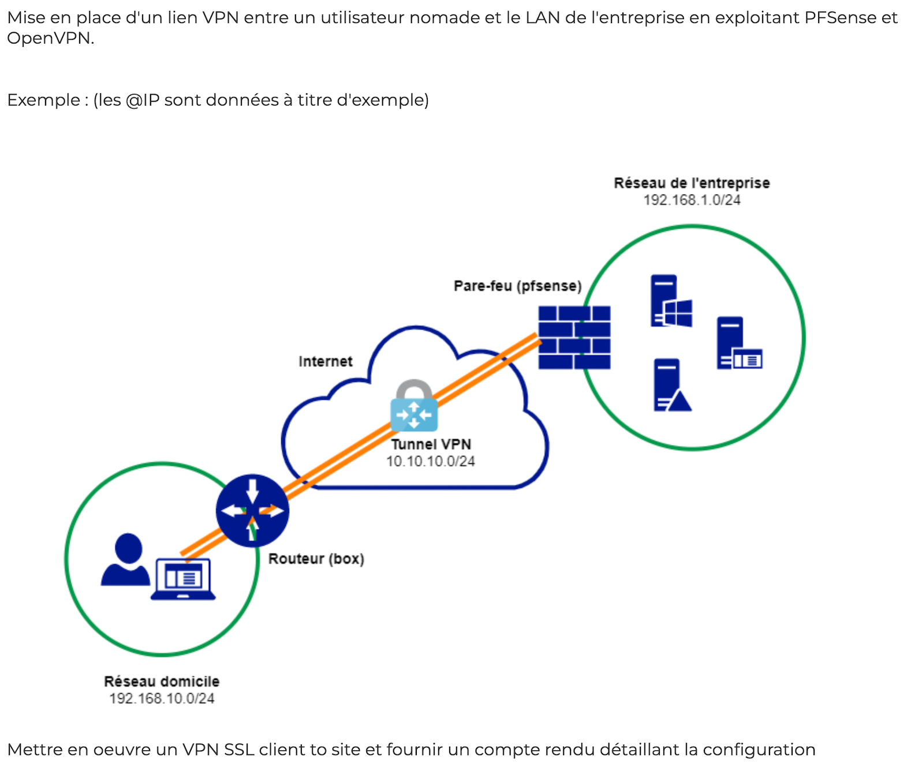

# VPN - OpenVPN

Vanhee Jean

1. Pour commencer nous allons créer donc 2 carte réseaux pour mettre en place le Pfsense (vmbr0 = WAN) et (LAN_Jean = LAN) 

1. Nous allons ensuite installé Pfsense depuis un Iso + la configuration des Ips WAN et LAN 

—> Configuration des Ips du Pfsense 

3. Acces au pfsense 

Nous allons donc mettre la carte réseaux du LAN (LAN_Jean) 

Nous mettons donc les Ips correspondantes sur la machine client sur le LAN 
192.168.1.10 255.255.255.0 Passerelle 192.168.1.1 et DNS 192.168.1.1

Connexion au Pfsense :  admin/pfsense

—>

Maintenant nous allons respecter cette ordre pour avoir un accès distant depuis un PC hors réseaux grace au VPN 

1. 6création de l’autorité de certification

Systhem —> certificates —> Authorities —> Add

—> save 

Nous pouvons voir que le certificat d’autorité a bien été créer et qu’il est valide pendant 10 ans 

1. Création d’un certificat pour notre serveur 

—> certificates —> Add

Nous avons bien notre certificat de server 

1. création de l’utilisateur (et sont certificat)

System —> User Manager —> Add 

Vérification : 

System - Certificate —> certificate 

Nous avons bien le certificat de l’utilisateur

1. Création de la configuration OpenVPN server

VPN —> OpenVPN —> server —> Add 

Nous allons mettre Remote access (SSL/TLS + User Auth) car c’est un access a distance qui va se baser sur un authentification par certificat et par compte utilisateur  

On va mettre local database car on a créer un compte utilisateur en local au Pfsense  

Interface WAN car on va monter la connexion VPN depuis la WAN 

Le certificat de server on prend celui qu’ont a crée 

 Tunnel settings —> 

Nous allons mettre le tunnel 10.10.10.0/24 pour le tunnel VPN 

Nous allons mettre les Ips local network, cela va permettre de rendre ces Ips accessible au travers du VPN  

ensuite dan Client settings nous pouvons cocher dynamic IP ce qui va permettre de maintenir le VPN pour des personne ou leurs Ip publique change, ce qui est bien pour ce qui travaille avec de la 4G/5G ou leurs Ips change 

de plus la topologie net30 permet pour chaque utilisateur qui se connecte au VPN se retrouve dans un réseaux isoler en /30 ce qui va permettre de ne pas communiquer avec les autres ordinateur qui sont eux aussi connecter au VPN  
ce qui est un bon point sur la sécurité mais le desavantage et que pour chaque connexion nous allons consommer 4 adresse IPs Adresse IP du PC/ Adresse de la passerelle/ Adresse sous-réseaux en /30 et son adresse  broadcast  + nous avons donc pas 254 IP disponible mais 254 / 4 = 

Adcanced Client settings —> 

Vérification de la configuration de OpenVPN 

 5. Exortation de la configuration OpenVPN 

Pour commencer nous allons devoir installé un packet sur le par-feu car nativement nous ne pouvons pas l’exporter au format OpenVPN

System —> package manager —> available Packages 

Ensuite nous allons retourner dans Open VPN et nous voyons bien que l’onglet client Export a été créer (cela va nous permettre d’exporter la config OpenVPN)

Nous nous rendons en bas dans l’onglet OpenVPN Client et nous intallons une Archive Zip qui contient le certificat et le fichier OpenVPN qui correspond a la configuration OpenVPN client to site 

et le fichier Windows va servir a donner aux utilisateurs pour qu’ils puissent se connecter 

Nous allons ajouter une nouvelle regles 

firewall —> rules —> Wan 

A partir de ce moment la nous pouvons nous connecter au VPN mais nous ne pouvons pas avoir acces au ressource interne 

Test 

Nous installons OpenVPN sur la machine a partir du fichier Windows que nous avons installé 
—> Nous nous mettons en DHCP et nous obtenons un Ip en .20.X 

—> nous nous connectons a OpenVPN avec l’utilisateur que nous avons créer 

Nous voyons bien que nous obtenons une Ip en 10.10.10.6, Le VPN est bien fonctionnel

1. Création des regles firewall de OpenVPN 

Normalement dans Firewall —> Rules nous avons OpenVPN qui a été créer 
C’est ici qu’on va créer des règles pour avoir access au ressources internes 

